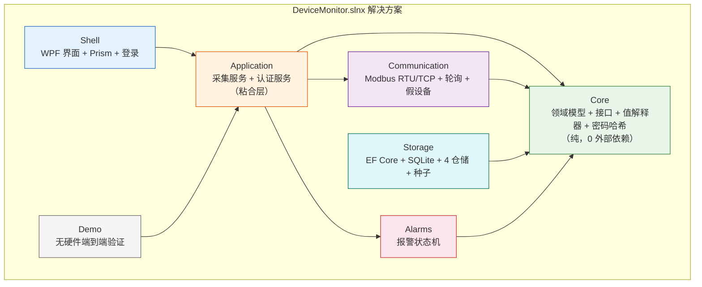
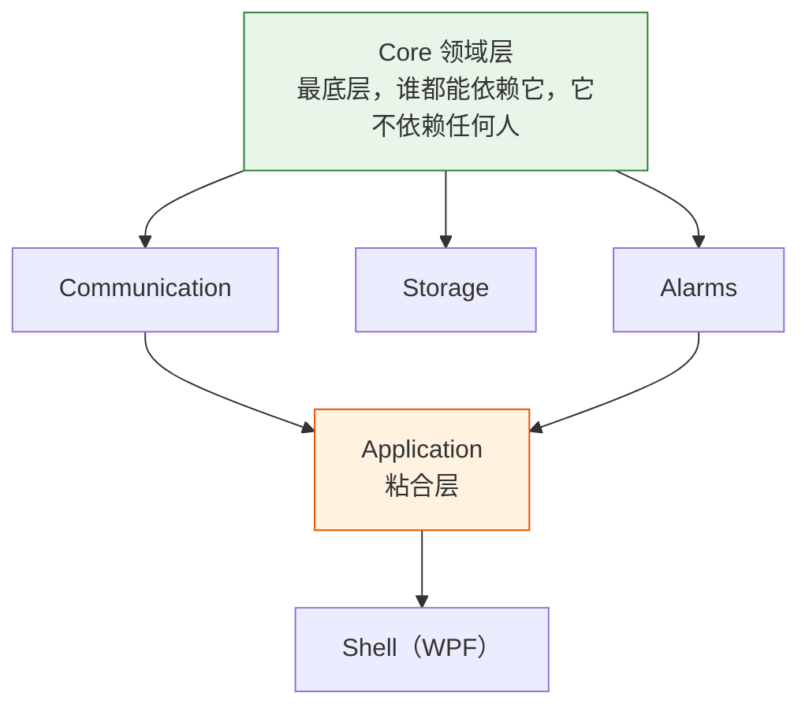
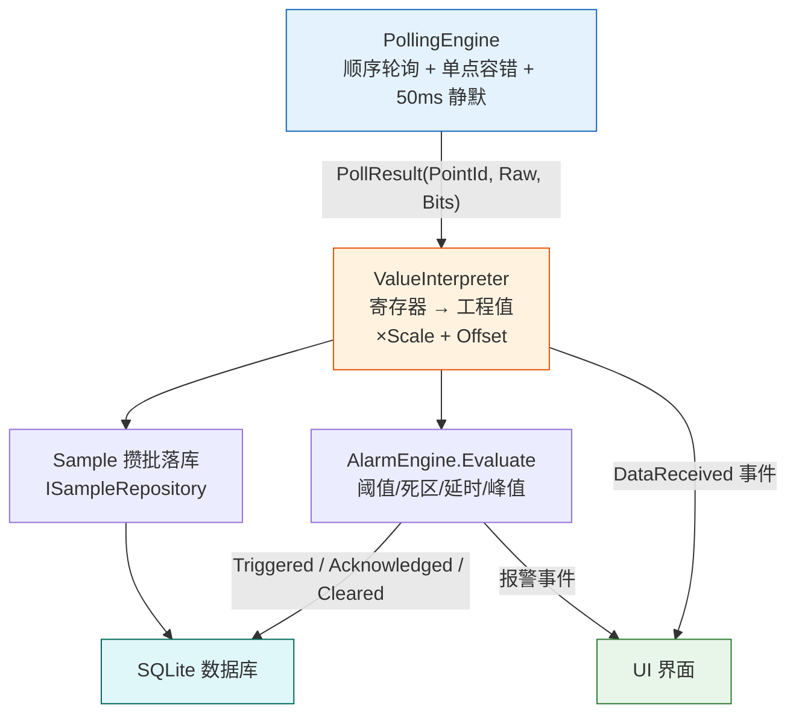
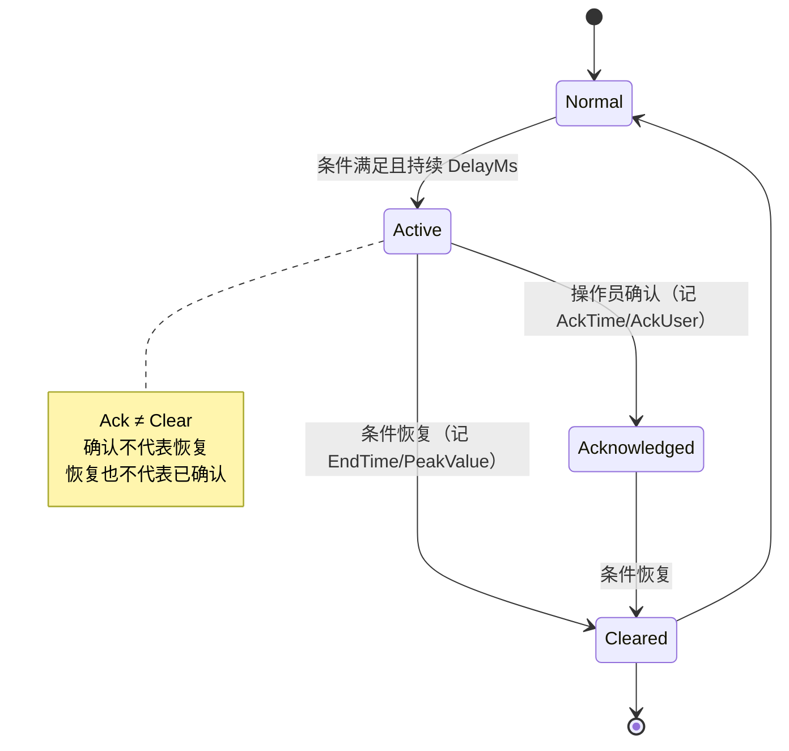

# DeviceMonitor 上位机项目文档

> 工业设备数据采集与监控上位机（SCADA/HMI），基于 WPF + Prism + NModbus + EF Core + SQLite。
> 项目位置：`D:\上位机\DeviceMonitor\`

---

## 一、项目概述

### 1.1 是什么

一个**工业设备数据采集与监控上位机**。通过 Modbus RTU（串口）和 Modbus TCP（以太网）采集多台工业设备的实时数据，提供实时监控、历史存储、阈值报警、登录权限等功能。

> ⚠️ 定位澄清：这是**上位机 / SCADA**，不是 MES。
> - 上位机管"设备现在怎么样"（温度多少、是否报警）
> - MES 管"订单做到哪一步了"（工单、工序、良率、追溯）
> 本项目站在五层工业架构的「监控层」，是 MES 之下、PLC 之上的数据采集层。

### 1.2 技术栈

| 层 | 技术 | 说明 |
|---|---|---|
| 运行时 | .NET 11 | LTS 最新 |
| UI | WPF | 桌面监控界面 |
| MVVM | Prism 8.1.97（DryIoc） | Region/Navigation/EventAggregator/DI |
| 通信 | NModbus 3.0.83 | Modbus RTU + TCP |
| 存储 | EF Core 11 + SQLite | 免部署、单机够用 |
| 报警 | 自研状态机 | 阈值 + 死区 + 延时 + 峰值 |
| 密码 | PBKDF2 | 哈希 + 盐，不存明文 |

### 1.3 项目规模

- 7 个项目、57 个源文件、约 4150 行
- 编译 0 警告 0 错误
- 已跑通链路：存储、报警、端到端采集（无硬件用假设备）、登录权限、断开提示

---

## 二、系统架构

### 2.1 分层架构（7 个项目）



> 图例：绿色=最底层领域层（0 依赖），橙色=粘合层，蓝色=界面层，其余=各自职责模块。

### 2.2 依赖方向（关键纪律）



**核心纪律**：
- **Application 层刻意不引用 Storage**——保持"应用层不依赖基础设施"的分层原则。仓储接口定义在 Core，实现在 Storage，Application 只依赖接口。
- **Core 零外部依赖**——`StopBits`/`Parity` 用 `int` 而非 `System.IO.Ports` 枚举，转换放在 Communication 层。

### 2.3 完整数据流



---

## 三、核心模块详解

### 3.1 通信层（Communication）

#### 通信抽象 `IDeviceClient`

整个架构的关键。上层轮询引擎只认这个接口，不关心底下是串口还是网口：

```csharp
public interface IDeviceClient : IDisposable
{
    bool IsOpen { get; }
    byte SlaveId { get; }
    bool Open();
    void Close();
    ushort[] ReadRegisters(ModbusArea area, ushort startAddress, ushort count);
    bool[] ReadBits(ModbusArea area, ushort startAddress, ushort count);
    void WriteSingleRegister(ushort address, ushort value);
    void WriteMultipleRegisters(ushort startAddress, ushort[] values);
    void WriteSingleCoil(ushort address, bool value);
    void WriteMultipleCoils(ushort startAddress, bool[] values);
    bool ProbeOnline();
    event Action<byte, bool>? OnHeartbeatResult;
    event Action<byte, bool>? OnSlaveStatusChanged;
}
```

**两个实现**：
- `ModbusRtuClient`（串口，511 行）
- `ModbusTcpClient`（以太网，363 行）

**两个工厂**：
- `DeviceClientFactory`（真设备：按 Protocol 返回 RTU 或 TCP）
- `SimulatedDeviceClientFactory`（假设备：永远返回 FakeDeviceClient）

> **加协议只需再实现一个 `IDeviceClient`**，上层一行不改。这是"可扩展协议"的落点。

#### 工业可靠性"六件套"

| 机制 | 实现 | 关键点 |
|---|---|---|
| CRC 校验 | NModbus 传输层自动 | RTU 有 CRC，TCP 无（靠 TCP 协议栈） |
| 掉线重连 | `EnsureConnected()` | **先 Close 再 Open**，不复用旧对象 |
| 异常分类重试 | `Execute()` 骨架 | `SlaveException` 不重试 / `Timeout` 重试 / `IOException` 先重连 |
| 双层重试 | 内层 NModbus + 外层自写 | 内层毫秒级对抗干扰，外层数百毫秒级等恢复 |
| 心跳 | `ProbeOnline()` | **返回异常码也算在线**（能应答=活着） |
| 结构化日志 | `IModbusLogSink` | 7 字段对象，可按从站/功能码过滤 |

**心跳"异常码算在线"是这个模块最有现场思维的点**：
> 从站寄存器地址配错返回 0x02，很多实现直接判离线，害运维去查硬件。实际上通信是好的，只是配置错了。判为在线能把问题指向配置层。

#### 轮询引擎 `PollingEngine`

三条铁律（来自 RS485 半双工总线特性）：

1. **顺序执行，不并发**——单线程遍历，一次只跟一个从站通信
2. **从站间 50ms 静默**——给总线释放时间
3. **单点容错**——某个测点失败记日志继续，绝不中断整轮

### 3.2 存储层（Storage）

#### 8 张表

| 表 | 实体 | 用途 |
|---|---|---|
| T_Devices | Device | 设备（含 RTU/TCP 参数） |
| T_DataPoints | DataPoint | 测点（区/地址/类型/量程） |
| T_Samples | Sample | 原始秒级采样 |
| T_SampleAggregates | SampleAggregate | 分钟/小时聚合（Avg/Min/Max/Count） |
| T_AlarmRules | AlarmRule | 报警规则（阈值/死区/延时） |
| T_AlarmRecords | AlarmRecord | 报警记录（状态机） |
| T_Users | UserAccount | 用户（哈希+盐） |
| T_AuditLogs | AuditLog | 审计日志 |

#### 关键索引

```csharp
// 采样表：历史查询永远是"按测点 + 按时间区间"
builder.HasIndex(x => new { x.DataPointId, x.Timestamp });

// 测点表：同设备下测点名唯一
builder.HasIndex(x => new { x.DeviceId, x.Name }).IsUnique();
```

#### 值解释器 `ValueInterpreter`

寄存器原始值 → 工程值，集中处理"字节序"这个坑：

```csharp
// 32 位类型：高字在前拼两个寄存器
DataValueType.UInt32 => (uint)((regs[0] << 16) | regs[1])
DataValueType.Float  => BitConverter.Int32BitsToSingle((int)((regs[0] << 16) | regs[1]))
// 最终工程值 = 原始值 × Scale + Offset
```

> ⚠️ 不同品牌 PLC 高低字顺序可能相反，32 位值明显不对时优先查这里。

#### 采样批量写入

`AcquisitionService` 里攒批（`_pendingSamples`），够 `batchSize` 才落库。高频采样下一条一 INSERT 会打满磁盘 IO。

### 3.3 报警层（Alarms）

#### 三层过滤（防报警风暴）

```
① 阈值判断   value > Threshold ?
② 死区过滤   回差 Deadband：超上限报，但必须低于 (上限 - 死区) 才恢复
③ 延时确认   持续 DelayMs 才真正产生报警（防止瞬时毛刺）
```

#### 状态机



**Ack 和 Clear 是两件独立的事**——确认不代表恢复，恢复也不代表已确认。

#### 死区滞回（三段逻辑）

```csharp
if (arm) return true;          // 越过触发阈值 → 报警
if (disarm) return false;      // 越过解除阈值 → 恢复
return currentlyArmed;         // 死区内 → 维持原状态
```

没有第三句，值在阈值附近抖动会反复报警、反复恢复。

#### 峰值追踪

High 类取最大值，Low 类取最小值，恢复时记录报警期间最严重的值——事后追溯能看到严重程度。

### 3.4 应用层（Application）

#### 采集服务 `AcquisitionService`

粘合层，把 Core/Comm/Storage/Alarms 串起来。数据流：

```
PollResult → ValueInterpreter → Sample 攒批落库
                              → AlarmEngine.Evaluate → 报警落库 + 事件
```

**它自己不碰硬件、不碰数据库细节、不碰 UI**，全部通过接口和事件解耦。

#### 认证服务 `AuthService`

```csharp
public bool CanWrite => CurrentUser?.IsAdmin == true;
```

权限模型两级：
- **Admin**：可看、可写（下发参数）
- **Operator**：只能看，写操作被拒（`EnsureCanWriteAsync` 拒绝 + 记审计）

### 3.5 安全

#### 密码哈希 `PasswordHasher`

```csharp
byte[] salt = RandomNumberGenerator.GetBytes(16);
byte[] hash = Rfc2898DeriveBytes.Pbkdf2(password, salt, 100_000, SHA256, 32);
```

- **PBKDF2** 而非 MD5/SHA（快哈希抗暴力弱）
- **每用户独立随机盐**（防彩虹表）
- **常数时间比较** `FixedTimeEquals`（防时序侧信道）

#### 审计日志

登录成功/失败、写操作被拒，全程记录。工业软件出事故要能追溯"谁在什么时候干了什么"。

---

## 四、假设备模式（无硬件开发）

### 4.1 开关位置

主界面顶部配置栏有一个**模式切换按钮**，点一下在【模拟模式】↔【真实模式】之间切换：

- 【模拟模式】→ 用 `FakeDeviceClient`（正弦波模拟温湿度）
- 【真实模式】→ 用 `ModbusRtuClient` / `ModbusTcpClient`（真串口/网口）

> ⚠️ 切换后要**先停止采集，再重新开始采集**才生效（客户端在 StartAsync 时才创建）。

实现是 `SwitchableDeviceClientFactory`（运行时可切换，无需重启）：

```csharp
public static bool IsSimulation { get; set; } = true;
// Create 时根据 IsSimulation 返回真/假客户端
```

### 4.2 原理

`SimulatedDeviceClientFactory` 返回 `FakeDeviceClient`，用正弦波模拟温度在 22.5~28.5℃ 波动（跨过 27℃ 阈值触发报警）。

**这是 `IDeviceClient` 抽象的最大价值**：测上层逻辑时用假实现替换真串口，整个采集/报警/UI 链路在无硬件下跑通。

---

## 五、默认账号

| 账号 | 密码 | 角色 | 权限 |
|---|---|---|---|
| `admin` | `admin123` | 管理员 | 可看、可写 |
| `operator` | `operator123` | 操作员 | 只能看，写操作被拒 |

种子数据在首次启动（空库）时自动创建。

> 账号密码只在"数据库为空"时种一次；删掉数据库文件重启可重新生成。

---

## 六、如何运行

### 6.1 命令行

```powershell
cd D:\上位机\DeviceMonitor
dotnet run --project src\DeviceMonitor.Shell
```

### 6.2 Visual Studio

1. 打开 `D:\上位机\DeviceMonitor\DeviceMonitor.slnx`
2. 右键 `DeviceMonitor.Shell` → 设为启动项目
3. F5

> ⚠️ 需要 VS 2022 17.13+ 才能打开 `.slnx`（新格式）。旧版用传统 `.sln`（可让 AI 生成）。

### 6.3 数据库位置

SQLite 文件在：
```
D:\上位机\DeviceMonitor\data\DeviceMonitor.db
```
可用 Letos（原 SQLiteStudio）/ DB Browser for SQLite 打开查看。

> 首次启动后该文件才生成（需先跑一次程序）。

### 6.4 无硬件联调（Modbus Slave 仿真）

完整的"无真实 PLC 联调"步骤：

```
① VSPD：建 COM1 ↔ COM2 虚拟串口对
② Modbus Slave（从站，注意不是 Modbus Poll）：
   Connection → Connect → 选 COM2，9600/8/None/1
   Setup → Slave Definition → Slave ID=1，Function=04，Address=0，Quantity=10
   主表格双击 Value 列：地址0填235(=23.5℃)，地址1填520(=52.0%RH)
③ 上位机程序：串口 COM1，从站1，保存配置 → 切真实模式 → 开始采集
④ 结果：程序显示温度 23.5℃、湿度 52.0%RH
```

> ⚠️ **主从关系**：
> - 你的上位机程序 = 主站（Master）
> - Modbus **Slave** = 从站（喂数据给你的程序）← **联调用这个**
> - Modbus **Poll** = 也是主站（跟你的程序同类，不能互连）← 测真实设备时才用它
>
> 值换算：`填的数字 × 0.1 = 程序显示的真实值`（因为测点 Scale=0.1）。

---

## 七、关键知识点清单（面试/答辩用）

### 7.1 上位机 vs MES（边界）

| 维度 | 上位机（本项目） | MES |
|---|---|---|
| 核心对象 | 设备、测点、寄存器 | 工单、工序、物料、人员 |
| 核心问题 | 设备读数多少？报警没？ | 订单做到哪？良率多少？ |
| 时间粒度 | 秒级 | 小时/班次 |
| 数据来源 | 直接读 Modbus | 从上位机拿 + 人工录入 |

### 7.2 通信可靠性（最容易讲深的部分）

- **异常分类**：SlaveException 不重试（重试结果不变）、Timeout 重试、IOException 先重连
- **双层重试**：内层毫秒级（NModbus 传输层）、外层数百毫秒级
- **心跳判在线**：异常码也算在线——能应答说明活着，只是配置错
- **轮询**：顺序执行 + 50ms 静默（RS485 半双工）+ 单点容错
- **断开/恢复检测**：设备级判定（一台设备所有测点全失败→离线），**状态跃变才触发**（只弹一次窗，不刷屏），离线弹窗+声音+状态栏红点，恢复自动变绿

### 7.3 报警引擎（业务逻辑最好讲的部分）

- 三层过滤：阈值 → 死区 → 延时
- 状态机：Normal → Active → Acknowledged → Cleared
- Ack ≠ Clear（确认不代表恢复）
- 峰值追踪：High 取 Max，Low 取 Min

### 7.4 架构（体现工程能力）

- 7 层分层 + 严格依赖方向（Application 不依赖 Storage）
- `IDeviceClient` 抽象 → 加协议不改上层（真串口/假设备/将来加 S7）
- 值解释器集中处理字节序
- 采样攒批 + 分页删除（SQLite 性能）
- **DbContext 工厂化**：每个操作独立 DbContext，避免跨线程共享（EF Core 线程安全核心）

### 7.5 安全

- PBKDF2 + 盐，不存明文
- 两级权限（操作员不能写）
- 审计日志全程追溯

---

## 八、已知限制与后续方向

### 已完成功能清单

- ✅ Modbus RTU/TCP 通信（重连/重试/心跳/轮询）
- ✅ 数据采集 + 量程换算（Scale/Offset + 字节序）
- ✅ 采样落库（SQLite，批量写入，DbContext 工厂化线程安全）
- ✅ 报警引擎（阈值/死区/延时/状态机/峰值）
- ✅ 假设备模式 + 运行时切换（无硬件可跑）
- ✅ WPF 界面（侧边导航 + 实时数据 + 报警列表 + 设备配置）
- ✅ 登录 + 两级权限 + 审计日志（PBKDF2 密码）
- ✅ 断开连接提示（弹窗 + 声音 + 状态栏红点）

### 已知限制

- 数据库结构用 `EnsureCreated`（简化版），未用 EF 迁移
- 左侧导航的「历史趋势/报警记录/设备配置/用户管理」是占位按钮，功能未做
- 历史曲线未做（当前只有实时表格）
- 参数下发只有权限演示，未真正写寄存器

### 后续方向（按性价比）

1. **历史曲线（LiveCharts2）**——实时趋势图
2. **历史查询页**——查过去采样 + 导出 CSV
3. **真正的参数下发**——写寄存器 + 二次确认
4. **用户管理界面**——增删用户、改密码
5. **降采样后台任务**——原始 7 天 / 分钟 1 年

---

## 九、参考资料

- 本地教材：`day02_上位机\...\上位机开发基础.md`（Modbus 协议 §5~§8）
- 本地案例：`day02_上位机\...\Monitor\`（ModbusRtuLib 参考实现）
- 上位机设计方案：`D:\deepseek workspace\上位机项目推荐与设计方案.md`
- GitHub 借鉴：
  - [IndustrialDAQ](https://github.com/lsiswin/IndustrialDAQ)（.NET8 + WPF + Prism 工业 DAQ）
  - [SharpSCADA](https://github.com/GavinYellow/SharpSCADA)（组态/SCADA，3055★）
  - [NModbus](https://github.com/NModbus/NModbus)（Modbus 库）
  - [LiveCharts2](https://github.com/Live-Charts/LiveCharts2)（图表库）
